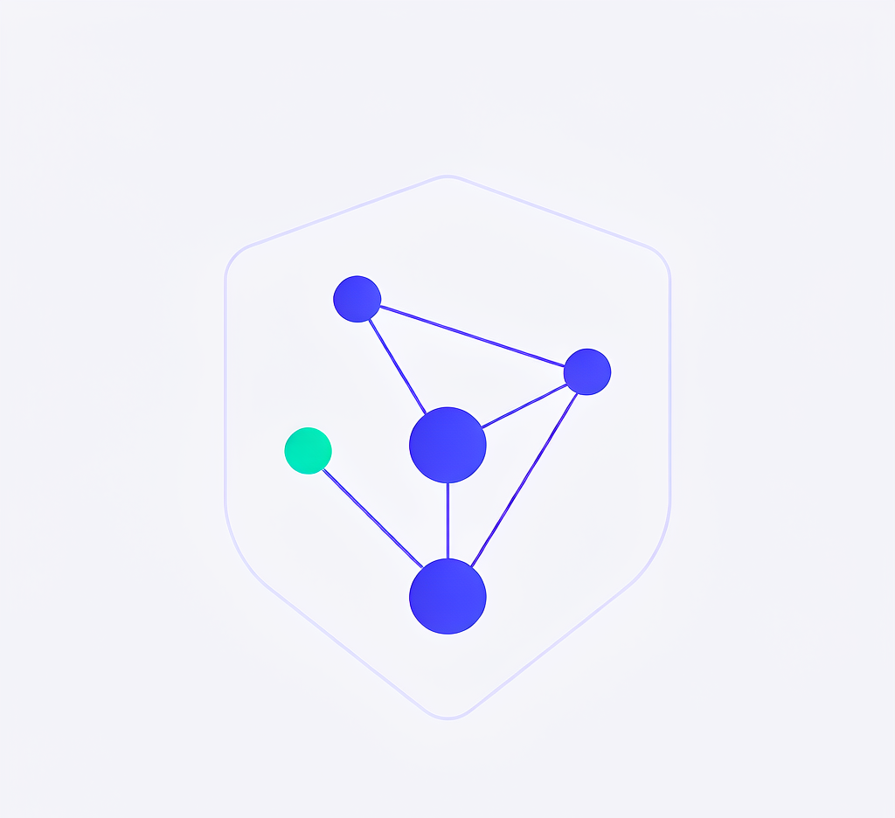
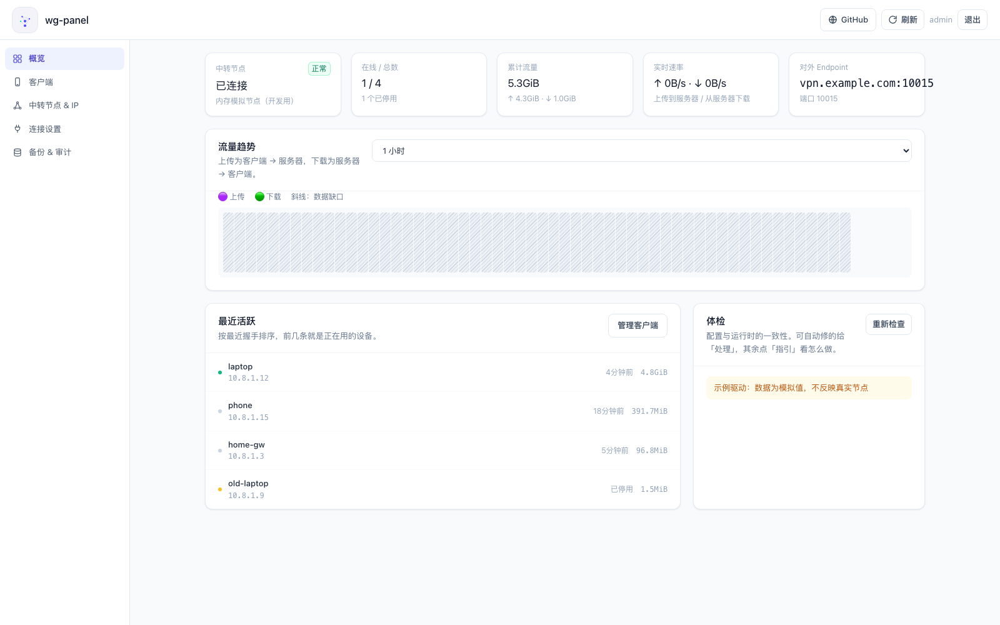
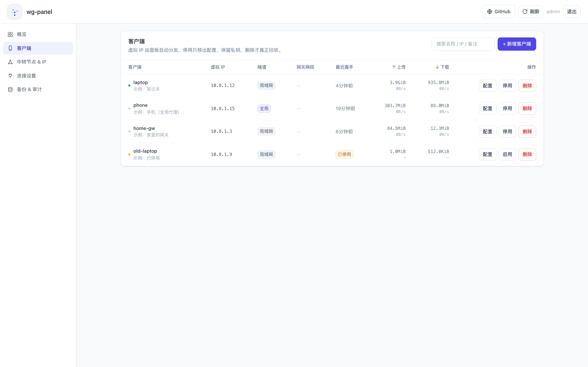
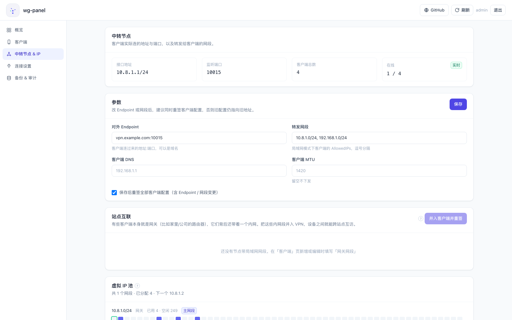
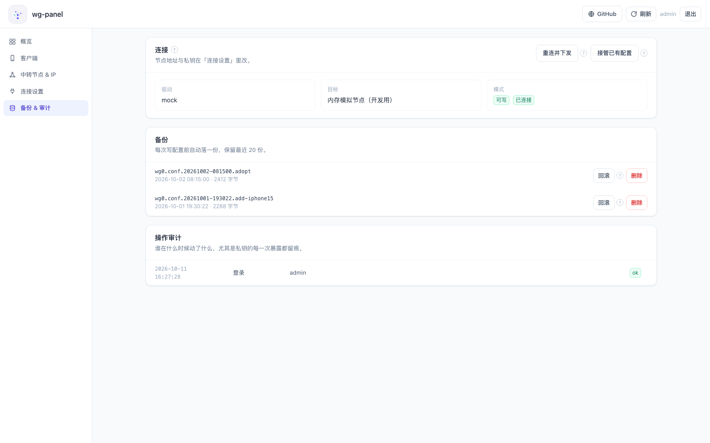

<div align="center">



# wg-panel

**WireGuard 云端可视化管理面板**

[](https://hub.docker.com/r/xueayis/wg-panel)
[](https://github.com/xueayi/wg-panel)

</div>

跑在 Docker 里，管理你的 WireGuard 中转节点，把「配节点、分虚拟 IP、发客户端配置」
做成界面。**面板不承载任何流量**——隧道始终是 客户端 ↔ 中转节点，它只是遥控器。

支持两种模式：

- **SSH 模式**（默认）：面板部署在哪都行，通过 SSH 远程纳管中转节点上的 WireGuard
- **本地模式**：面板与 linuxserver/wireguard 容器共享同一网络空间，直接管理本机接口，不需要 SSH

## 快速开始

```bash
cp docker-compose.example.yml docker-compose.yml
# 只需改两处：WGP_ADMIN_PASSWORD（初始密码）、WGP_SECRET_KEY（openssl rand -hex 32）
docker compose up -d
```

浏览器打开 `http://<部署机IP>:13010`，初始账号 **`admin` / `admin`**，然后：

**「连接设置」→ 填中转节点地址 + SSH 凭证（密钥或密码）→ 点「测试连接」** —— 就这三步。
节点相关的一切都在面板里配，不用改 compose、也不用在部署机上放私钥。

> 忘了密码？改过初始密码后顶栏会一直提醒；重置方法见教程。

### 本地模式（可选）

面板和 WireGuard 跑在同一台机器、不想经过 SSH 时，用本地模式：

```bash
cp docker-compose.local.example.yml docker-compose.yml
# 同样只改 WGP_ADMIN_PASSWORD 与 WGP_SECRET_KEY
docker compose up -d
```

- 面板通过 `network_mode: service:wireguard` 加入 linuxserver/wireguard 容器的网络空间，直接执行 `wg` / `ip` 管理接口，无需任何 SSH 凭证
- 首次打开面板 →「系统」页 → **纳管**：先预览（识别已有 peer，只读），确认后接管；之后的增删改全部在界面完成
- 配置存放在 `./config/`（两容器共享），面板数据在 `./data/`；端口映射写在 wireguard 服务上（默认 `13010`），已占用就换个宿主机端口
- 驱动由 `WGP_DRIVER` 在**启动时固定**，两种模式不能热切换；换模式需重建容器（面板和 WireGuard 要一起重建以重新加入网络空间）

## 功能

| | |
|---|---|
| 中转节点 | Endpoint、监听端口、转发网段、客户端 DNS/MTU，改完一键重签所有客户端配置 |
| 虚拟 IP | 自动分配最小空闲地址，支持静态 IP 与**多网段扩展**，占用一屏可见，删除后回收 |
| 客户端 | 新增 / 停用 / 启用 / 删除（删前自动备份）；扫码、下载 `.conf`、复制文本三件套 |
| 站点互联 | 给网关节点填「网关网段」，一键把所有站点网段并入客户端配置 |
| 安全网 | 每次写配置前自动备份（可回滚、可删单份）、一键体检（能修的直接修）、操作审计 |

## 界面

| 概览 | 客户端 |
|---|---|
| [](docs/screenshots/dashboard.png) | [](docs/screenshots/peers.png) |

| 中转节点 & IP | 备份 & 审计 |
|---|---|
| [](docs/screenshots/server.png) | [](docs/screenshots/system.png) |

## 文档

- **[从零开始接入你的中转节点](docs/guide/getting-started.md)** —— 中转节点准备 → 部署 → 纳管 → 扫码导入 → 站点互联
- [原理讲解](https://blog.xueayi.site/article/wireguard) —— WireGuard 组网与 `AllowedIPs` 的双侧语义

## 设计要点

- **登记表是权威数据**，`wg0.conf` 是它渲染出来的产物；变更一律走 `wg syncconf`（原子、不断线），写前自动备份
- **WireGuard 语义只在 [`agent/wgagent.py`](agent/wgagent.py) 实现一次**，面板侧不重写第二份渲染/同步逻辑
- 私钥与密码只落盘 600 文件，接口只回**指纹**（OpenSSH 风格 `SHA256:…`）；破坏性操作需二次确认

## 环境变量

只有两个需要关心（其余都有默认值，且能在面板里改）：

| 变量 | 说明 |
|---|---|
| `WGP_ADMIN_PASSWORD` | 初始密码，仅**第一次启动**用于初始化账号 |
| `WGP_SECRET_KEY` | 会话签名密钥，建议 `openssl rand -hex 32` |
| `WGP_DRIVER` | `ssh`（默认）、`local`（Docker 同网络空间）或 `mock`（开发） |
| `WGP_API_TOKEN` | 可选只读 API token，支持 `X-API-Token` 或 Bearer |

需要直接管理同一 Docker 中的 WireGuard 时，复制 `docker-compose.local.example.yml`（详见上文「本地模式」）；
面板和 WireGuard 必须一起重建以重新加入网络空间。

只读 API 示例：

```bash
curl -H "X-API-Token: $WGP_API_TOKEN" http://127.0.0.1:13010/api/state
curl -H "Authorization: Bearer $WGP_API_TOKEN" 'http://127.0.0.1:13010/api/traffic?window=3600'
```

节点地址、SSH 端口/用户、认证方式、接口名等见 `.env.example`（只是初始值，在「连接设置」里改更省事）。

## 开发

```bash
cd frontend && npm install && npm run dev          # 前端 5173，已代理 /api

cd backend && pip install -r requirements.txt
WGP_DRIVER=mock WGP_DATA_DIR=./data uvicorn app.main:app --reload
# WGP_DRIVER=mock 用内存里的假节点，不碰任何真实资源

cd backend && pytest tests -q --basetemp=/tmp/wg-panel-pytest   # 102 条，不碰真实 /etc/wireguard

cd frontend && node --test tests/regressions.test.mjs             # 6 条界面回归
```
